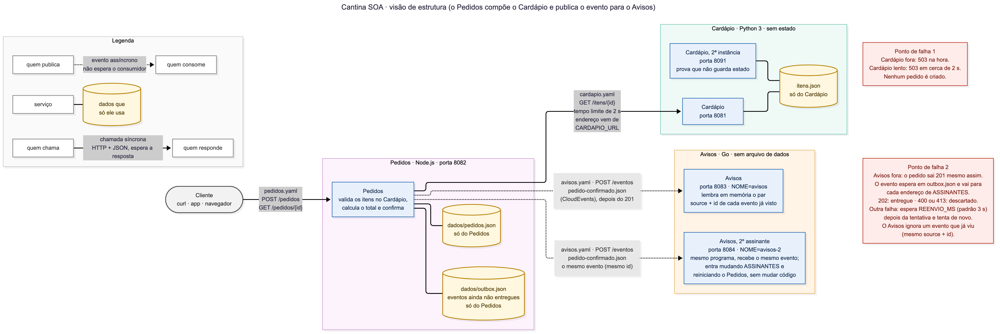
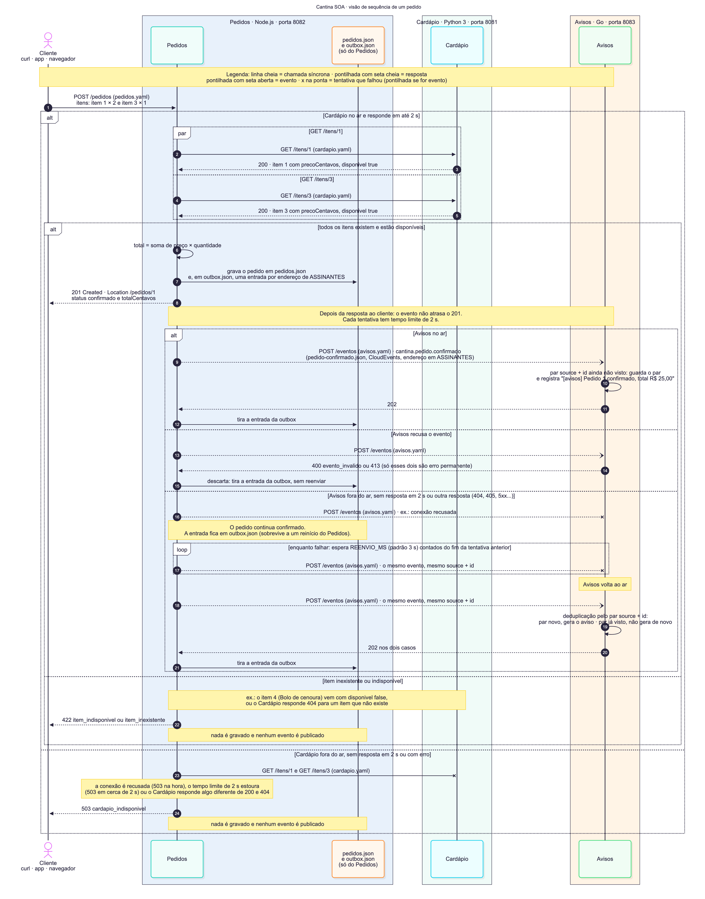

# Cantina SOA

Laboratório de Arquitetura Orientada a Serviços (FIAP · CheckPoint 3). A cantina do câmpus
recebe pedidos pelo celular e avisa quando o pedido é confirmado. O sistema tem três serviços
pequenos, e o que liga um ao outro é só o contrato.

| Serviço | O que faz | Linguagem | Porta |
|---|---|---|---|
| **Cardápio** | Informa o que há para vender | Python 3 (biblioteca padrão) | 8081 (segunda instância na 8091) |
| **Pedidos** | Registra a compra consultando o Cardápio e publica o evento de pedido confirmado | Node.js (biblioteca padrão) | 8082 |
| **Avisos** | Reage quando um pedido é confirmado | Go (biblioteca padrão) | 8083 (segundo assinante na 8084) |

Cada serviço está em uma linguagem diferente de propósito: se o contrato basta para eles se
entenderem, nenhum precisa saber como o outro foi escrito. Os serviços não dividem código, banco
nem arquivo. O contrato é a única coisa em comum.

## Grupo

| Nome | RM |
|---|---|
| João Victor Franco | 556790 |
| Lucca Borges | 554608 |
| Ruan Melo | 557599 |
| Rodrigo Jimenez | 558148 |
| Bruno Leão | 555563 |

## Como rodar

Pré-requisitos: Python 3.9+, Node.js 18+, Go 1.21+ e `curl`. Nada para instalar com `pip`,
`npm` ou `go get`: os três serviços usam só a biblioteca padrão. Todos os comandos abaixo partem
da raiz do repositório.

### Atalho: os três de uma vez

```bash
bash scripts/subir.sh
```

Sobe o Cardápio (8081), o Avisos (8083) e o Pedidos (8082) num terminal só, com o Pedidos já
publicando para o Avisos. Cada linha de log sai com o nome do serviço na frente. `Ctrl+C` derruba
os três. Os dados do Pedidos ficam numa pasta temporária, então cada subida começa do pedido 1.
No Windows, rode pelo Git Bash.

Os scripts (`subir.sh` e os das missões) usam as portas oficiais, mas cada uma muda por variável:
`PORTA_CARDAPIO` (8081), `PORTA_CARDAPIO2` (8091), `PORTA_PEDIDOS` (8082), `PORTA_AVISOS` (8083)
e `PORTA_AVISOS2` (8084), cada script lendo as que usa. Ex.: `PORTA_PEDIDOS=9082 bash scripts/subir.sh`.

### Um serviço por terminal (bash: Linux, macOS, Git Bash, Codespaces)

Nesta ordem, cada comando no seu terminal:

```bash
# 1. Cardápio, duas instâncias (a segunda mostra que ele não guarda estado)
PORTA=8081 python3 servicos/cardapio/app.py
PORTA=8091 python3 servicos/cardapio/app.py

# 2. Avisos, dois assinantes (o segundo só muda o nome no log)
cd servicos/avisos && PORTA=8083 go run .
cd servicos/avisos && PORTA=8084 NOME=avisos-2 go run .

# 3. Pedidos, apontando para o Cardápio e para os dois Avisos
PORTA=8082 CARDAPIO_URL=http://localhost:8081 \
  ASSINANTES=http://localhost:8083/eventos,http://localhost:8084/eventos \
  node servicos/pedidos/server.js
```

Neste modo os pedidos ficam guardados em `servicos/pedidos/dados/` (`pedidos.json` e
`outbox.json`) e continuam lá de uma subida para outra, então o número do pedido segue a
sequência (o exemplo abaixo pode não dar o pedido 1). Para recomeçar do pedido 1, pare o Pedidos
e apague a pasta `servicos/pedidos/dados/`. Ela não vai para o Git (`.gitignore`).

### PowerShell (Windows)

Os comandos de PowerShell não foram testados pelo grupo numa máquina Windows. Lá o Python costuma
se chamar `python`, as variáveis são definidas com `$env:` e o `curl` de verdade é o `curl.exe`.

```powershell
# 1. Cardápio
$env:PORTA="8081"; python servicos/cardapio/app.py
$env:PORTA="8091"; python servicos/cardapio/app.py

# 2. Avisos
cd servicos\avisos; $env:PORTA="8083"; go run .
cd servicos\avisos; $env:PORTA="8084"; $env:NOME="avisos-2"; go run .

# 3. Pedidos
$env:PORTA="8082"; $env:CARDAPIO_URL="http://localhost:8081"; $env:ASSINANTES="http://localhost:8083/eventos,http://localhost:8084/eventos"; node servicos/pedidos/server.js
```

### Um pedido de exemplo

```bash
curl -i -X POST http://localhost:8082/pedidos -H "Content-Type: application/json" --data @servicos/pedidos/pedido.json
```

No PowerShell: `curl.exe -i -X POST http://localhost:8082/pedidos -H "Content-Type: application/json" --data "@servicos/pedidos/pedido.json"`.

A resposta é `201` com `totalCentavos` 2500 (2 coxinhas e 1 suco). No terminal do Avisos
aparece `[avisos] Pedido 1 confirmado, total R$ 25,00`, e no do segundo, a mesma linha com
`[avisos-2]` (o número do pedido pode ser outro se `servicos/pedidos/dados/` já tinha pedidos).
Para consultar o pedido, use o número do header `Location`, como
`curl -i http://localhost:8082/pedidos/1`.

### Variáveis de ambiente

| Serviço | Variável | Obrigatória | Padrão | Para quê |
|---|---|---|---|---|
| Cardápio | `PORTA` | sim | nenhum | Porta em que o serviço escuta |
| Pedidos | `PORTA` | sim | nenhum | Porta em que o serviço escuta |
| Pedidos | `CARDAPIO_URL` | sim | nenhum | Raiz do Cardápio, como `http://localhost:8081` (sem `/itens`) |
| Pedidos | `ASSINANTES` | não | vazia: não publica nada | Endereços que recebem o evento, separados por vírgula |
| Pedidos | `REENVIO_MS` | não | `3000` (mínimo 100) | Quanto esperar, em milissegundos, depois de uma tentativa de entrega que falhou (contando do fim dela) antes da próxima. Não é um relógio fixo |
| Pedidos | `DADOS_DIR` | não | `servicos/pedidos/dados` | Pasta do `pedidos.json` e do `outbox.json` |
| Avisos | `PORTA` | sim | nenhum | Porta em que o serviço escuta |
| Avisos | `NOME` | não | `avisos` | Nome da instância, entre colchetes, no começo de cada log |

Detalhes de cada serviço: [Cardápio](servicos/cardapio/README.md),
[Pedidos](servicos/pedidos/README.md) e [Avisos](servicos/avisos/README.md).

## Contratos

| Arquivo | O que descreve |
|---|---|
| [`contratos/cardapio.yaml`](contratos/cardapio.yaml) | OpenAPI do Cardápio: `GET /itens`, `GET /itens/{id}` e `GET /saude`. É o padrão da turma, igual em todos os grupos |
| [`contratos/pedidos.yaml`](contratos/pedidos.yaml) | OpenAPI do Pedidos (versão 1.1.1): `POST /pedidos`, `GET /pedidos/{id}`, `GET /saude` e os erros `400`, `404`, `422` e `503` |
| [`contratos/pedido-confirmado.json`](contratos/pedido-confirmado.json) | Exemplo do evento `cantina.pedido.confirmado`, no envelope CloudEvents 1.0, com `pedidoId` e `totalCentavos` (o formato do enunciado) |
| [`contratos/pedido-confirmado.schema.json`](contratos/pedido-confirmado.schema.json) | As regras do mesmo evento em JSON Schema 2020-12: atributos obrigatórios do envelope e tipos, `type` sempre `cantina.pedido.confirmado`, `pedidoId` inteiro a partir de 1 e `totalCentavos` inteiro a partir de 0, em centavos. O par `source` + `id` identifica o evento e é o que o Avisos usa para deduplicar |
| [`contratos/avisos.yaml`](contratos/avisos.yaml) | OpenAPI do Avisos: o `POST /eventos` da Trilha A, com `202` (inclusive para evento repetido e tipo desconhecido), `400` e `413` |
| [`contratos/catalogo.json`](contratos/catalogo.json) | Catálogo dos serviços, o "portal de APIs" do grupo (veja abaixo) |

Os contratos vieram antes do código. O histórico do Git mostra isso: a tag `entrega-1` tem os três
primeiros contratos (`cardapio.yaml`, `pedidos.yaml` e `pedido-confirmado.json`), o README e o
desenho inicial, e nenhuma linha de código. O `avisos.yaml` (com o schema do evento) entrou na
Entrega 4, num commit anterior ao do código do Avisos.

O `pedidos.yaml` subiu para a 1.1.0 num commit anterior ao do código do Pedidos. As respostas
das rotas não mudaram, mas o corpo do pedido ganhou limites: no máximo 20 itens e quantidade de 1
a 1000. Por isso a mudança não é 100% compatível: um pedido que antes era aceito, com 21 itens
ou 5000 unidades, agora recebe `400`. Isso só afeta pedidos fora do razoável para uma cantina. O
enum de `codigo` também ganhou três valores (`rota_inexistente`, `metodo_nao_permitido` e
`erro_interno`), usados só fora das rotas do contrato. A 1.1.1 só documentou o limite de 1 MiB do
corpo, que o código já aplicava.

O **catálogo** (`contratos/catalogo.json`) é a lista dos serviços num lugar só: para cada um, o
nome, a linguagem, o contrato, a porta padrão, a variável pela qual quem o consome recebe o
endereço (`CARDAPIO_URL` para o Cardápio, `ASSINANTES` para o Avisos) e a rota de saúde
(`GET /saude`), e também o evento, com quem publica e quem assina. É um documento para pessoas:
quem chega no projeto (ou outro grupo, na prova de fogo) descobre ali o que existe e onde. Nenhum
serviço lê o catálogo; os endereços continuam vindo por variável de ambiente.

Regra do grupo: se o código e o contrato discordam, o código está errado.

## Testes e evidências

Cada script grava a saída em `evidencias/`. Os das missões 2 e 3 precisam dos serviços no ar;
o da Missão 4 sobe e derruba tudo sozinho.

| Missão | Script | Evidência | O que prova |
|---|---|---|---|
| 2 | [`scripts/missao2.sh`](scripts/missao2.sh) | [`evidencias/missao2.txt`](evidencias/missao2.txt) | O Cardápio segue o contrato: lista, item, `404` de item inexistente, `/saude`, e as instâncias 8081 e 8091 respondem igual |
| 3 | [`scripts/missao3.sh`](scripts/missao3.sh) | [`evidencias/missao3.txt`](evidencias/missao3.txt) | O Pedidos compõe o Cardápio: `201` com total 2500, consulta do pedido, `422` para item indisponível e inexistente (sem criar pedido). Depois, os modos `cardapio-fora` (`503` na hora) e `cardapio-lento` (um simulador ocupa a porta do Cardápio, aceita a conexão e nunca responde: `503` em cerca de 2 s), os dois gerados pelo script |
| 4 | [`scripts/missao4.sh`](scripts/missao4.sh) | [`evidencias/missao4.txt`](evidencias/missao4.txt) | O evento chega ao Avisos; com o Avisos fora o pedido sai `201` em milissegundos e, quando ele volta, o reenvio entrega o pedido 2; o mesmo evento mandado de novo recebe `202` e `repetido, ignorado`, sem novo aviso; com o Avisos fora e o Pedidos reiniciado, a outbox guarda o pedido 3 e ele chega uma vez só; um segundo Avisos recebe o pedido 4 depois de mudar `ASSINANTES` e reiniciar o Pedidos (mesmo hash dos `.js` antes e depois) |

```bash
bash scripts/missao2.sh                   # com o Cardápio na 8081 e na 8091 (zera o arquivo)
bash scripts/missao3.sh                   # com o Cardápio (8081) e o Pedidos (8082) (zera o arquivo)
bash scripts/missao3.sh cardapio-fora     # depois de parar o Cardápio; acrescenta ao arquivo
bash scripts/missao3.sh cardapio-lento    # com o Cardápio ainda parado; acrescenta ao arquivo
bash scripts/missao4.sh                   # com as portas 8081 a 8084 livres
```

Os modos `cardapio-fora` e `cardapio-lento` conferem antes que o Cardápio está mesmo fora e param
sem gravar nada se ele responder. O `missao4.sh` só substitui `evidencias/missao4.txt` se todas
as conferências passarem; com `Ctrl+C` ou uma falha, o arquivo antigo fica como estava. Ele e o
`subir.sh` conferem antes que as suas portas estão livres e param com erro se alguma estiver em uso.

## Trilha de eventos

O grupo escolheu a **Trilha A (webhook)**. O Pedidos lê da variável `ASSINANTES` uma lista de
endereços e faz `POST /eventos` em cada um com o evento `cantina.pedido.confirmado`.

Por quê:

- Não precisa de infraestrutura extra. Não há broker para instalar, configurar ou manter no ar.
- Roda no Codespaces ou em qualquer máquina com Python, Node e Go.
- O professor avalia sem instalar nada além do que os serviços já pedem.

O ponto fraco do webhook, que a simulação da aula mostra, é que o evento se perde se o
consumidor estiver fora do ar na hora. Resolvemos assim:

- **Outbox no Pedidos.** O evento é gravado em `outbox.json` antes do `201`, e um despachante
  entrega em segundo plano. Se a entrega falha, o evento fica na outbox, e o Pedidos tenta de novo
  `REENVIO_MS` (padrão 3 s) depois do fim de cada tentativa que falhou, inclusive depois de um
  reinício do Pedidos. Só `400` e `413` são erro permanente (é o que `avisos.yaml` define) e
  descartam o evento; qualquer outra resposta que não seja 2xx (`404`, `405`, `5xx`...) é tentada
  de novo, e num `404` ou `405` o log pede para conferir o endereço em `ASSINANTES`. Corrigir
  `ASSINANTES` vale só para pedidos novos: a entrada que já está na outbox fica presa ao endereço
  errado, e para tirá-la é preciso parar o Pedidos e apagá-la do `outbox.json`. Código:
  `servicos/pedidos/outbox.js` e `servicos/pedidos/publicador.js`.
- **Deduplicação no Avisos.** O reenvio pode entregar o mesmo evento duas vezes. O Avisos lembra
  o par `source` + `id` de cada evento (é o que identifica um evento no CloudEvents) e, se ele
  chegar de novo, responde `202` sem repetir o aviso. Código: `servicos/avisos/main.go`, método
  `marcar` de `idsProcessados`.

O resultado é entrega "pelo menos uma vez" sem aviso duplicado, dentro dos limites descritos em
[Limites conhecidos](#limites-conhecidos).

## Arquitetura



A estrutura mostra os três serviços, a porta de cada um, os dados que só ele usa, o contrato em
cada seta e os dois pontos de falha.



A sequência mostra um pedido do começo ao fim: consulta ao Cardápio, `201`, e o evento indo ao
Avisos depois da resposta, com os caminhos de erro e de reenvio.

Legenda, fontes `.mmd` e como renderizar de novo: [`arquitetura/README.md`](arquitetura/README.md).

## Matriz de princípios

Princípio sem evidência não conta. Cada linha aponta para um arquivo que dá para abrir.

| Princípio | Onde aparece no nosso código |
|---|---|
| **Contrato padronizado** | Os contratos vieram antes do código: a tag `entrega-1` tem três (`cardapio.yaml`, `pedidos.yaml` e `pedido-confirmado.json`) e nenhuma linha de código; o `avisos.yaml` entrou na Entrega 4, num commit anterior ao do código do Avisos. O evento também tem um schema (`contratos/pedido-confirmado.schema.json`). O Pedidos valida a entrada pelo `NovoPedido` do contrato (`servicos/pedidos/server.js`, função `validarNovoPedido`) e responde no formato `Erro` (função `responderErro`). O evento sai no envelope de `contratos/pedido-confirmado.json` (`servicos/pedidos/publicador.js`, função `criarEvento`), e o Avisos confere o envelope (`servicos/avisos/main.go`, função `validarEnvelope`). |
| **Baixo acoplamento** | O Pedidos conhece o Cardápio só pelo endereço em `CARDAPIO_URL` e os assinantes só por `ASSINANTES` (`servicos/pedidos/server.js`, funções `lerConfiguracao` e `lerAssinantes`). Do Cardápio ele lê só `precoCentavos`, `disponivel` e `nome` e ignora o resto (`servicos/pedidos/cardapio.js`, função `consultarItem`). Evidência: `evidencias/missao4.txt`, Passo 6, um segundo Avisos entra mudando `ASSINANTES` e reiniciando o Pedidos, com o mesmo hash dos `.js`. |
| **Abstração** | Quem chama vê só o contrato, não o que há por trás. O Cardápio lê `itens.json` (`servicos/cardapio/app.py`, função `carregar_itens`), mas o contrato só fala em `GET /itens/{id}`. As falhas internas do Pedidos viram um código do contrato: `CardapioIndisponivel` (`servicos/pedidos/cardapio.js`) vira `503 cardapio_indisponivel` (`servicos/pedidos/server.js`, função `criarPedido`), e a outbox não aparece em nenhuma resposta. |
| **Reuso** | O Cardápio atende qualquer consumidor HTTP sem que ninguém copie a regra de preço: o `curl` direto de `evidencias/missao2.txt` e o Pedidos (`evidencias/missao3.txt`, total 2500 calculado com o `precoCentavos` do Cardápio, `servicos/pedidos/cardapio.js`) usam a mesma API, e o Pedidos não guarda preço nenhum. O mesmo programa do Avisos roda como dois assinantes, `avisos` e `avisos-2`, só por configuração (`PORTA` e `NOME`; `servicos/avisos/main.go`, função `main`; `evidencias/missao4.txt`, Passo 6). Dentro do Pedidos, a gravação segura `gravarJson` (`servicos/pedidos/armazenamento.js`) é reusada pela outbox (`servicos/pedidos/outbox.js`). |
| **Autonomia** | Cada serviço é dono dos seus dados: `servicos/cardapio/itens.json`, `pedidos.json` e `outbox.json` do Pedidos (`servicos/pedidos/armazenamento.js` e `outbox.js`), e os ids do Avisos em memória. Uma falha não derruba o vizinho: com o Avisos fora o pedido sai `201` (`evidencias/missao4.txt`, Passo 2), e com o Cardápio fora o Pedidos responde `503` na hora, e com ele lento em cerca de 2 s (medido: 2,002 s), e segue atendendo (`servicos/pedidos/cardapio.js`, `TEMPO_LIMITE_MS` em `consultarItens`; `evidencias/missao3.txt`). |
| **Ausência de estado** | O Cardápio não guarda nada sobre quem chama: só o dado de referência `ITENS`, carregado na subida (`servicos/cardapio/app.py`). Por isso as instâncias 8081 e 8091 respondem igual (`evidencias/missao2.txt`). No Pedidos cada requisição traz tudo o que precisa e o estado fica em arquivo, não na conversa: o pedido volta igual em `GET /pedidos/{id}` (`evidencias/missao3.txt`). O Avisos guarda um estado de propósito, os ids já vistos (`servicos/avisos/main.go`, tipo `idsProcessados`), só para não repetir aviso. |
| **Descoberta** | O catálogo `contratos/catalogo.json` lista os serviços num lugar só: contrato, porta padrão, a variável pela qual o consumidor recebe o endereço (`CARDAPIO_URL`, `ASSINANTES`) e a rota de saúde. Os OpenAPI dizem onde o serviço está (`servers` em `contratos/pedidos.yaml` e `contratos/avisos.yaml`; o `cardapio.yaml` é o padrão da turma e não tem `servers`, então a porta dele está só no catálogo), e os três respondem `GET /saude` (`servicos/cardapio/app.py`, `do_GET`; `servicos/pedidos/server.js`, `tratar`; `servicos/avisos/main.go`, `tratarSaude`). Ao subir, o Pedidos chama o `/saude` do Cardápio e avisa se `CARDAPIO_URL` está errado (`servicos/pedidos/server.js`, função `conferirCardapio`). O catálogo é para pessoas: nenhum serviço o lê, e não há registro automático; o endereço vem por configuração. |
| **Composição** | O Pedidos é uma composição: consulta o Cardápio em paralelo, item por item (`servicos/pedidos/cardapio.js`, função `consultarItens`, chamada em `criarPedido`), e publica o evento para o Avisos (`servicos/pedidos/publicador.js`, funções `publicar` e `despachar`). Evidência: total 2500 calculado com os preços do Cardápio (`evidencias/missao3.txt`) e o aviso chegando no Avisos (`evidencias/missao4.txt`). |

## Prova de fogo (Missão 3)

**Pendente: fazer na aula de 19/10.** Apontar `CARDAPIO_URL` para o Cardápio de outro grupo, de
preferência em outra linguagem, e repetir o `POST /pedidos` sem alterar uma linha do Pedidos.
Ela vai confirmar na aula, entre grupos, o reuso e o baixo acoplamento da matriz acima; até lá,
ela não conta como evidência.

| Grupo parceiro | Linguagem do Cardápio deles | Resultado |
|---|---|---|
| _a preencher_ | _a preencher_ | _a preencher_ |

## Demonstração

**▶ [Vídeo de 51 s da demonstração](evidencias/demonstracao.mp4)**: este roteiro rodando de verdade,
os três serviços e o cliente em quatro painéis, do primeiro pedido até o Avisos voltar e receber o
segundo.

Roteiro para o vídeo ou a apresentação, em bash, na raiz do repositório, um serviço por terminal
(assim dá para derrubar só o Avisos com `Ctrl+C`):

1. Terminal 1: `PORTA=8081 python3 servicos/cardapio/app.py`.
2. Terminal 2: `cd servicos/avisos && PORTA=8083 go run .`.
3. Terminal 3: `PORTA=8082 CARDAPIO_URL=http://localhost:8081 ASSINANTES=http://localhost:8083/eventos node servicos/pedidos/server.js`.
4. Terminal 4: faça um pedido com o `curl` de [Um pedido de exemplo](#um-pedido-de-exemplo).
   Volta `201`, e no terminal 2 aparece `[avisos] Pedido N confirmado, total R$ 25,00` (N é o
   número do pedido; apague `servicos/pedidos/dados/` antes para começar do 1).
5. `Ctrl+C` no terminal 2: o Avisos sai do ar.
6. Faça outro pedido no terminal 4. Volta `201` na hora, e no terminal 3 o Pedidos avisa que a
   entrega falhou e que vai tentar de novo em 3 s.
7. Religue o Avisos no terminal 2 (`PORTA=8083 go run .`). Em poucos segundos aparece o aviso do
   segundo pedido: nada se perdeu.
8. `Ctrl+C` nos terminais 1, 2 e 3 para encerrar.

Com o `bash scripts/subir.sh` os três ficam num terminal só, e o `Ctrl+C` derruba todos juntos;
para derrubar só o Avisos nesse modo seria preciso achar o PID dele, por isso o roteiro acima usa
um terminal por serviço. O `bash scripts/missao4.sh` faz o mesmo roteiro de forma automática, e
ainda mostra a deduplicação, a outbox sobrevivendo a um reinício do Pedidos e um segundo Avisos
entrando só mudando `ASSINANTES` e reiniciando o Pedidos, sem mudar código.

## Limites conhecidos

- **O Avisos lembra os eventos só em memória.** Um reinício do Avisos esquece os pares
  `source` + `id` já vistos; um evento reenviado depois disso gera o aviso de novo.
- **Pedido e evento são gravados em dois arquivos.** O Pedidos grava primeiro o pedido em
  `pedidos.json` e logo depois o evento em `outbox.json`. Se o processo cair exatamente entre as
  duas gravações, o pedido fica confirmado e o evento daquele pedido se perde. A ordem é de
  propósito: o evento leva o id do pedido, e perder um aviso é menos grave que avisar um pedido
  que não existe (o que aconteceria na ordem inversa). Um banco de dados resolveria gravando os
  dois na mesma transação.
- **O reenvio não tem limite de tentativas.** Um assinante que nunca volta, ou um endereço errado
  em `ASSINANTES`, faz o Pedidos tentar para sempre (o log mostra cada tentativa).
- **Os comandos de PowerShell não foram testados** pelo grupo numa máquina Windows.

## Estrutura do repositório

```
cantina-soa/
├── contratos/          os contratos, escritos antes do código
│   ├── cardapio.yaml
│   ├── pedidos.yaml
│   ├── pedido-confirmado.json
│   ├── pedido-confirmado.schema.json
│   ├── avisos.yaml
│   └── catalogo.json   catálogo dos serviços (o "portal de APIs" do grupo)
├── servicos/
│   ├── cardapio/       Python: app.py e itens.json
│   ├── pedidos/        Node.js: server.js, cardapio.js, armazenamento.js, outbox.js, publicador.js
│   └── avisos/         Go: main.go
├── scripts/
│   ├── subir.sh        sobe os três serviços num terminal só
│   ├── missao2.sh
│   ├── missao3.sh
│   └── missao4.sh
├── arquitetura/        fontes .mmd e imagens do desenho
├── evidencias/         saídas dos scripts de cada missão
└── README.md           como rodar, trilha de eventos e matriz de princípios
```

## Entregas

| Tag | O que entrou | Prazo do laboratório |
|---|---|---|
| `entrega-1` | Contratos do Cardápio, do Pedidos e do evento; desenho inicial | 12/10 |
| `entrega-2` | Cardápio em Python e a evidência da Missão 2 | 19/10 |
| `entrega-3` | Pedidos em Node.js compondo o Cardápio, contrato do Pedidos 1.1.0 e a evidência da Missão 3 | 26/10 |
| `entrega-4` | Contrato `avisos.yaml` e schema do evento (antes do código), Avisos em Go, outbox com reenvio no Pedidos, `subir.sh` e a evidência da Missão 4 | 2/11 |
| `entrega-5` | README final com a matriz de princípios e o catálogo dos serviços, desenhos atualizados e a seção da prova de fogo (o teste com outro grupo fica para a aula de 19/10) | 6/11 |
